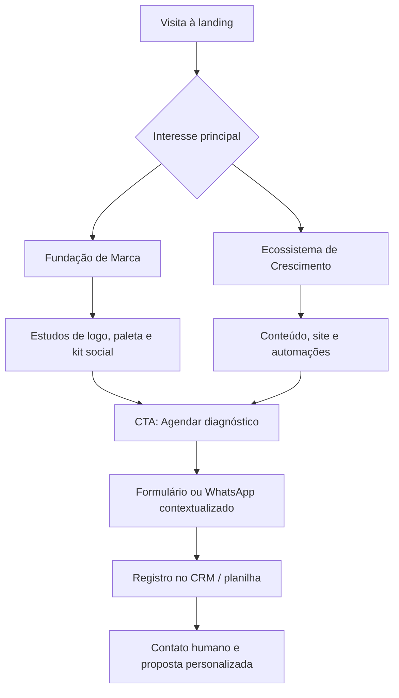

# PRD — Proposta Digital Godoy Corretor

**Status:** pronto para criação da landing page comercial demonstrativa  
**Versão:** 1.0 · 16/08/2026  
**Objetivo:** transformar a presença digital do corretor em uma marca imobiliária percebida como confiável, contemporânea e preparada para captar, qualificar e converter oportunidades.

---

## 1. Resumo executivo

Esta proposta não é apenas uma reformulação de Instagram. É a construção de um sistema comercial digital integrado para o **Godoy Corretor**: marca consistente, conteúdo que valoriza os imóveis, uma vitrine própria e jornadas de atendimento rastreáveis.

O cliente potencial deverá enxergar duas portas de entrada claras:

1. **Fundação de Marca** — corrigir a percepção atual, criar ativos profissionais e padronizar a comunicação.
2. **Ecossistema de Crescimento** — manter a presença ativa, receber leads qualificados e direcioná-los a uma visita.

> **Promessa da solução:** tornar a apresentação dos imóveis tão cuidadosa quanto a negociação, reduzindo atritos entre o primeiro contato e o agendamento.

---

## 2. Contexto e diagnóstico inicial

### Evidências observadas no perfil atual

| Pilar | Situação observada | Risco de negócio | Direção proposta |
|---|---|---|---|
| Credibilidade | Erros de escrita visíveis, como “Residedencial” e “2 Qurtos”. | Redução de confiança em uma decisão de alto valor. | Revisão editorial e aprovação antes de toda publicação. |
| Identidade | Tipografias genéricas, contornos pesados e estilos inconsistentes. | Feed sem memória de marca e aspecto pouco premium. | Sistema visual proprietário e templates modulares. |
| Fotografia | Luz, enquadramento e perspectiva variam entre as peças. | Os imóveis aparentam menos valor do que possuem. | Direção de arte, tratamento e padrão de captação. |
| Conversão | Link direto e genérico para WhatsApp; ausência de qualificação. | Perda de contexto, leads frios e atendimento reativo. | Landing page, CTAs rastreáveis e fluxo de triagem. |
| Organização | Destaques e conteúdo não comunicam uma jornada clara. | O visitante não entende rapidamente portfólio, regiões e diferenciais. | Destaques por intenção, prova social e categorias. |

### Hipóteses a validar no onboarding

- Área de atuação prioritária, bairros e faixas de ticket.
- Perfil mais rentável: compra, venda, locação, lançamento, investimento ou imóvel de lazer.
- Inventário disponível, fontes de captação e frequência de atualização.
- CRECI, razão social quando aplicável, regras de divulgação de preços e parceiros.
- Tempo de resposta, responsável pelo atendimento e CRM já utilizado.

Esses pontos serão confirmados em uma reunião de descoberta; a landing demonstrativa deverá sinalizar campos configuráveis onde ainda não houver definição.

---

## 3. Objetivos, indicadores e limites de escopo

### Objetivos estratégicos

1. Elevar a percepção de profissionalismo e especialização local.
2. Apresentar imóveis com consistência visual e informação objetiva.
3. Converter interesse em conversas identificadas, não apenas cliques sem contexto.
4. Dar ao corretor um processo simples para responder e acompanhar oportunidades.
5. Criar uma base escalável para mídia paga, catálogo e CRM.

### Métricas de sucesso

| Funil | Indicador | Como medir |
|---|---|---|
| Marca | Consistência de publicações e aprovação editorial | calendário e checklist mensal |
| Interesse | Salvamentos, compartilhamentos e visualizações qualificadas | Insights do Instagram |
| Aquisição | Cliques em CTAs e formulários iniciados | GA4 / tags de campanha |
| Qualificação | Leads com região, faixa de orçamento e objetivo preenchidos | planilha ou CRM |
| Conversão | Agendamentos e visitas realizadas | CRM / registro do corretor |
| Atendimento | Tempo até a primeira resposta | WhatsApp Business / CRM |

**Importante:** resultados de vendas, alcance ou volume de leads dependem de inventário, verba, velocidade de atendimento, sazonalidade e execução do cliente. A proposta entrega estrutura, criação e otimização; não garante vendas ou métricas específicas.

---

## 4. Público e posicionamento

### Públicos prioritários

- **Comprador residencial:** busca segurança, clareza de valores e agilidade para visitar.
- **Investidor:** quer localização, liquidez, potencial de uso e dados objetivos.
- **Proprietário vendedor:** precisa confiar na apresentação, divulgação e condução comercial.
- **Comprador de litoral/segunda residência:** valoriza atendimento próximo, estilo de vida e logística regional.

### Posicionamento recomendado

**Godoy Corretor — corretor de imóveis com atendimento direto e consultivo, do primeiro contato à escritura.**

Tom de voz: seguro, acessível, consultivo e objetivo. Evitar linguagem de urgência artificial, superlativos vazios e promessas não comprováveis.

### Bio sugerida (a validar com região e CRECI)

> Corretor de imóveis em **[região de atuação]**  
> Residenciais, oportunidades e atendimento consultivo  
> CRECI **[número/UF]** · Agende sua visita ↓

### Recomendação de @usuário

Avaliar disponibilidade e aderência de alternativas como `@godoycorretor`, `@godoyimoveis` ou `@godoy.imoveis.[cidade]`. A alteração deve ser precedida de checagem de disponibilidade, preservação de links e comunicação aos seguidores; não deve ser feita somente por estética.

---

## 5. Solução proposta e entregáveis

### Fase 1 — Fundação de Marca (projeto pontual)

| Entrega | Escopo de fato | Critério de aceite |
|---|---|---|
| Imersão estratégica | briefing, análise de concorrência local e definição de público prioritário. | mapa de direcionamento aprovado. |
| Naming de apresentação | recomendação de uso da marca pessoal e assinatura profissional. | nome de exibição e assinatura definidos. |
| Logotipo | **3 rotas conceituais iniciais**, com uma rodada de seleção; desenvolvimento de **1 rota final** com até 2 rodadas de refinamento. | marca aprovada em versão horizontal, compacta e monocromática. |
| Sistema visual | paleta, tipografia, grafismos, ícones de apoio e direção de imagem. | kit de marca documentado. |
| Kit de arquivos | SVG, PNG transparente, JPG e PDF para usos digitais; versões claro/escuro conforme necessário. | arquivos organizados e entregues. |
| Manual essencial | guia prático de uso de logo, cores, tipografia, espaçamento e exemplos sociais. | PDF/arquivo digital aprovado. |
| Perfil Instagram | bio revisada, nome de exibição, link de bio, avatar e estrutura de destaques. | perfil configurado ou checklist de implementação entregue. |
| Kit social inicial | capas de destaques e templates editáveis para capa de imóvel, carrossel, depoimento e oportunidade. | peças aprovadas em formatos corretos. |

**Diretriz para imagens de conceito:** mockups e imagens assistidas por IA podem ser utilizados para explorar atmosfera e apresentações, sempre identificados internamente como conceituais. Imagens de imóveis anunciados devem ser reais, licenciadas/autorizadas e não podem simular características inexistentes.

### Direção visual recomendada

| Elemento | Especificação |
|---|---|
| Azul petróleo | `#123B45` — confiança, profundidade e institucionalidade. |
| Dourado champagne | `#C7A46A` — sofisticação em detalhes, sem excessos. |
| Off-white gelo | `#F5F3EE` — fundos claros e respiro. |
| Grafite | `#202426` — legibilidade e contraste. |
| Tipografia primária | Inter ou Montserrat — dados, interface e leitura rápida. |
| Tipografia de destaque | Playfair Display — títulos editoriais e momentos premium. |

As três rotas de logo para a apresentação deverão explorar: **(A) monograma G geométrico**, **(B) assinatura tipográfica consultiva** e **(C) símbolo arquitetônico minimalista**. A landing deve mostrá-las como estudos de direção, nunca como marcas finais já aprovadas.

### Fase 2 — Presença de Conteúdo (recorrência mensal)

**Pacote-base sugerido: 12 entregas por mês**

| Entrega mensal | Quantidade | Inclui |
|---|---:|---|
| Carrosséis estratégicos | 4 | pauta, copy, design e CTA; até 6 slides por peça. |
| Reels de imóvel ou autoridade | 4 | roteiro de até 45 s, edição de material fornecido, legendas e capa. |
| Posts estáticos/prova social | 4 | design, legenda e CTA. |
| Calendário editorial | 1 | pauta mensal, objetivo e data sugerida. |
| Relatório de performance | 1 | leitura de indicadores, aprendizados e próximos testes. |

**Pilares editoriais:** imóveis em destaque; guias de bairros/região; educação de compra e venda; bastidores e autoridade; prova social; oportunidades e chamadas para visita.

**Fluxo de aprovação:** pauta → material do imóvel → criação → uma rodada consolidada de ajustes → agendamento/publicação. Alterações de escopo, reedições por troca de imóvel e demandas urgentes são orçadas à parte ou compensadas no calendário.

### Padrão de produção audiovisual

- Reels com abertura de interesse nos primeiros segundos, tour objetivo, dados essenciais e CTA.
- Correção de cor, enquadramento e perspectiva dentro dos limites do material captado.
- Legendas sincronizadas e acessíveis; áudio licenciado ou disponível na plataforma.
- Captação presencial, drone, locução profissional, modelos, tour 360° e renderizações são complementos contratáveis, não inclusos no pacote-base.

### Fase 3 — Site e vitrine digital (projeto pontual)

#### Produto recomendado: landing page comercial responsiva

Uma página rápida, mobile-first, desenhada para apresentar a marca e direcionar a conversa. O catálogo completo com filtros é uma evolução posterior, indicada somente se houver processo confiável de atualização de inventário.

| Seção | Objetivo | Conteúdo demonstrativo |
|---|---|---|
| Hero | comunicar posicionamento e gerar ação imediata. | proposta de valor, foto/visual de marca e CTA “Encontrar meu imóvel”. |
| Diferenciais | criar confiança rapidamente. | atendimento direto, informação verificada, conhecimento regional e transparência. |
| Imóveis em destaque | provar qualidade de apresentação. | 3 a 6 cards ilustrativos identificados como demonstração até receber inventário. |
| Regiões | organizar a busca por intenção. | cidades/bairros prioritários configuráveis. |
| Como funciona | reduzir atrito do atendimento. | descoberta, seleção, visita e negociação. |
| Prova social | reduzir insegurança. | depoimentos autorizados; placeholders não devem ser publicados como reais. |
| CTA de qualificação | transformar interesse em lead contextualizado. | formulário curto + WhatsApp com mensagem pré-preenchida. |
| Rodapé | assegurar transparência. | CRECI, contatos, política de privacidade e links sociais. |

**Incluído no MVP:** UX/UI, desenvolvimento responsivo, formulário, links rastreáveis, SEO técnico básico (títulos, descrições, sitemap quando aplicável), integração de analytics mediante acesso e página de privacidade.

**Não incluído sem aditivo:** painel administrativo, integração com portais/CRM, busca avançada, login, pagamentos, hospedagem/domínio, fotografia e cadastro recorrente de imóveis. Esses itens podem formar uma Fase 4 após a validação do MVP.

### Fase 4 — Conversão, automação e dados (opcional)

| Canal | Fluxo viável | Dependências |
|---|---|---|
| WhatsApp Business | botão com contexto do imóvel; triagem por interesse, região, orçamento e prazo; encaminhamento para humano. | número Business, política de privacidade, ferramenta aprovada e responsável pelo atendimento. |
| Instagram Direct | respostas salvas e automações autorizadas pela plataforma para palavras-chave/comentários. | conta profissional, ferramenta compatível e consentimento quando necessário. |
| Formulário do site | captação mínima de dados, origem da campanha e envio a e-mail/CRM. | destino de leads definido e base legal LGPD. |
| CRM | pipeline: novo → contato → qualificado → visita → proposta → ganho/perdido. | escolha/configuração de CRM e disciplina operacional. |

Automação deve acelerar o primeiro atendimento, não substituí-lo. Mensagens serão transparentes sobre serem automáticas quando aplicável, terão opção de atendimento humano e não enviarão comunicações promocionais sem base legal/consentimento apropriado.

---

## 6. Requisitos funcionais da landing de apresentação

### Primários

- Exibir claramente as duas modalidades: **Fundação de Marca** e **Ecossistema de Crescimento**.
- Permitir navegação por âncoras e CTA de proposta/reunião.
- Apresentar comparativo de escopo sem preço fechado; usar “solicitar proposta” até precificação e margem serem definidas.
- Exibir mockups de logo, feed, carrossel, reel e site como demonstrações conceituais.
- Possuir formulário: nome, WhatsApp, e-mail, principal objetivo e melhor horário para contato.
- Abrir WhatsApp com mensagem contextualizada ao clicar nos CTAs.
- Ser legível em mobile e desktop, com contraste adequado e navegação por teclado básica.

### Conteúdo e UX

- Linguagem de consultoria: diagnóstico → oportunidade → solução → processo → convite.
- Uma CTA principal por seção; evitar poluição com múltiplos links concorrentes.
- Informar que portfólio, números e depoimentos são exemplos/placeholder enquanto não forem validados pelo corretor.
- Não publicar preço, disponibilidade, localização precisa ou imagem de imóvel sem autorização e atualização confirmada.

### Não funcionais

- Priorizar carregamento rápido, imagens otimizadas e layout sem deslocamentos relevantes.
- Implementar tags de analytics somente com aviso de cookies/consentimento adequado quando exigido.
- Formulários devem minimizar coleta de dados e proteger o envio (HTTPS e acesso limitado).
- Código e ativos organizados para futura expansão de catálogo e campanhas.

---

## 7. Arquitetura da landing demonstrativa

### Ordem de seções recomendada

1. Hero com diagnóstico sutil e CTA.
2. “O cenário atual não traduz o potencial do negócio”.
3. Antes/depois conceitual: consistência, clareza e conversão.
4. Fundação de Marca — três direções de logo e sistema visual.
5. Ecossistema de Crescimento — conteúdo, site e automação.
6. Mockups de entregáveis e amostras de feed.
7. Processo em quatro etapas.
8. Comparativo de pacotes/escopo.
9. FAQ de escopo e responsabilidades.
10. CTA final para reunião estratégica.

---

## 8. Jornada operacional e responsabilidades

| Etapa | Agência/equipe especialista | Cliente/corretor |
|---|---|---|
| Descoberta | conduzir briefing e documentar estratégia. | fornecer prioridades, região, CRECI, inventário e referências. |
| Marca | propor direções e produzir ativos aprovados. | escolher rota e consolidar feedback no prazo. |
| Conteúdo | criar pautas, copies, peças e edições conforme escopo. | enviar fotos, vídeos, dados e autorizações corretos. |
| Site | projetar, desenvolver e configurar elementos contratados. | fornecer domínio, acessos, textos legais e validação final. |
| Automação | desenhar fluxo e configurar ferramenta definida. | manter ferramenta, responder leads e respeitar regras de canal/LGPD. |
| Otimização | relatar dados e recomendar testes. | executar atendimento e informar desfechos no CRM. |

### Cronograma indicativo

| Semana | Marco |
|---:|---|
| 1 | kickoff, briefing, auditoria e estratégia de posicionamento. |
| 2 | apresentação de três rotas visuais e arquitetura da landing. |
| 3 | refinamento da identidade, kit social e conteúdo-piloto. |
| 4 | design/desenvolvimento da landing e revisão de conteúdo. |
| 5 | QA, configurações de tracking/contato, treinamento e lançamento. |
| Após lançamento | operação mensal, relatório e otimização contínua. |

Prazos começam após recebimento de briefing, acessos, materiais e aprovações. O cronograma final será fechado na proposta comercial.

---

## 9. Governança, conformidade e riscos

- Toda divulgação deve conter informações corretas, condições aplicáveis e identificação profissional exigida pelo CRECI/legislação local.
- A aprovação final de preço, disponibilidade, metragem, endereço, fotos e condições comerciais é do corretor/anunciante.
- Dados pessoais de leads serão tratados somente para finalidades informadas, com acesso restrito e política de retenção definida.
- Não utilizar depoimentos, indicadores, “vendido”, imagens de imóveis ou antes/depois sem autorização verificável.
- Verificar direitos de imagem, música e material de incorporadoras/parceiros antes da publicação.
- A escolha de ferramentas de Meta/WhatsApp dependerá das políticas vigentes, permissões da conta e custos de terceiros.

---

## 10. Critérios de aceite e handoff

### Fundação de Marca

- Arquivos finais abrem corretamente nos formatos acordados.
- Paleta, tipografias e regras principais estão documentadas.
- Bio, destaques e templates estão aprovados pelo cliente.

### Landing

- Todos os CTAs funcionam em mobile e desktop.
- Formulário entrega os dados ao destino acordado e possui mensagem de confirmação.
- Conteúdo legal, contatos, CRECI e consentimentos foram validados pelo cliente.
- Não há placeholders apresentados como fatos reais no lançamento.

### Operação mensal

- Calendário e entregas concluídos dentro do escopo contratado.
- Relatório apresenta atividade, sinais de desempenho e recomendação acionável, sem promessa de resultado.

---

## 11. Próximos passos para fechar e iniciar

1. Apresentar esta landing como diagnóstico e visão de futuro, não como crítica ao perfil atual.
2. Conduzir reunião de descoberta de 45–60 minutos para validar público, região, inventário e objetivo comercial.
3. Fechar primeiro a **Fundação de Marca** como projeto de entrada e já reservar a continuidade mensal.
4. Definir escopo final, investimento, responsáveis, ferramentas e prazos em proposta/contrato.
5. Solicitar briefing, acessos, CRECI, fotos/vídeos autorizados e referências antes da produção.

### Perguntas de fechamento sugeridas

- “Hoje, qual tipo de imóvel e cliente você mais quer atrair?”
- “Em que ponto você sente que perde mais oportunidades: apresentação, resposta ou acompanhamento?”
- “Se a sua marca transmitisse o nível de confiança que você entrega no atendimento, o que isso mudaria nas suas captações?”
- “Faz mais sentido começarmos pela base da marca e ativarmos a máquina de conteúdo e conversão em seguida?”

---

## 12. Itens necessários antes de publicar a demonstração

- Nome completo/profissional, CRECI e cidades/regiões corretas.
- Foto de perfil e fotos/vídeos com autorização de uso.
- Telefone WhatsApp Business, Instagram, e-mail e responsáveis por resposta.
- Prova social e dados de portfólio que possam ser usados publicamente.
- Decisão sobre domínio/hospedagem, CRM e ferramenta de automação.
- Aprovação explícita dos textos, conceitos visuais e qualquer imagem demonstrativa.

---

## Anexo — Brief para geração dos estudos visuais

**Estilo:** imobiliário contemporâneo, elegante e confiável; azul petróleo, dourado champagne, off-white e grafite; geometria arquitetônica discreta; composição limpa; aparência premium sem ostentação.  
**Evitar:** chaves, casas genéricas, prédios clip-art, degradês excessivos, contornos pesados, dourado brilhante, texto ilegível e promessas visuais que não representem o negócio real.

Os estudos devem ser apresentados em mockups de avatar, cartão digital, capa de destaque, capa de carrossel e hero de landing para demonstrar aplicação — não para substituir os arquivos vetoriais finais da marca.